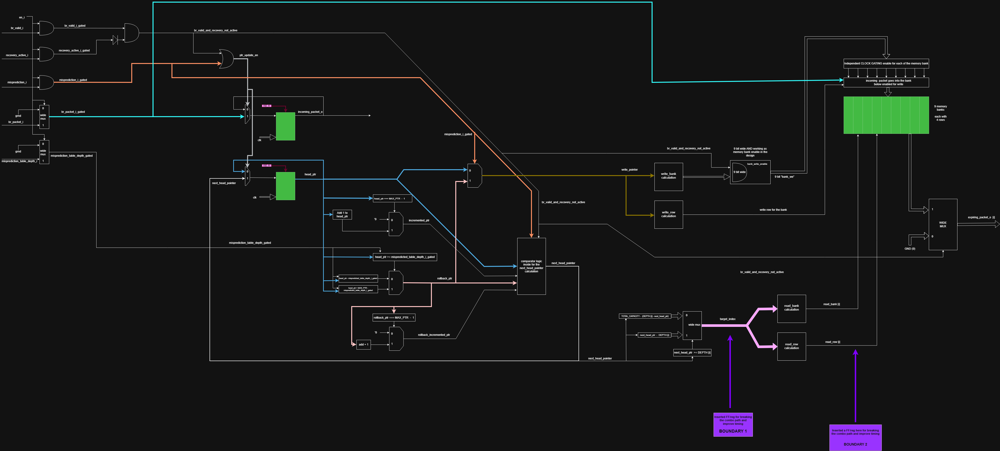
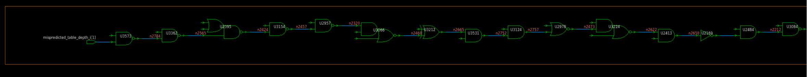
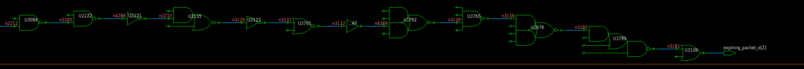
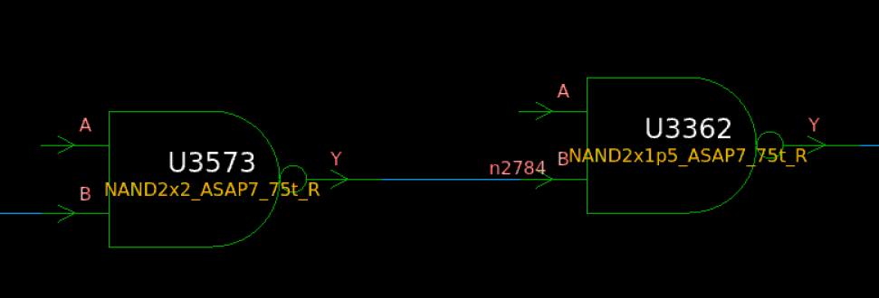
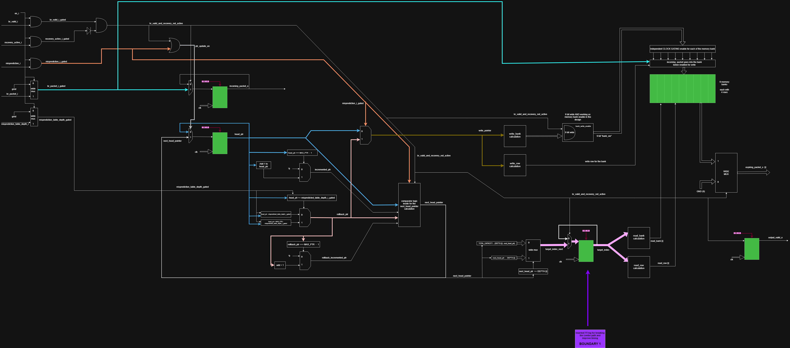
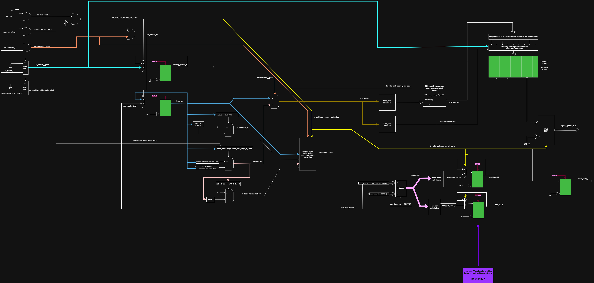
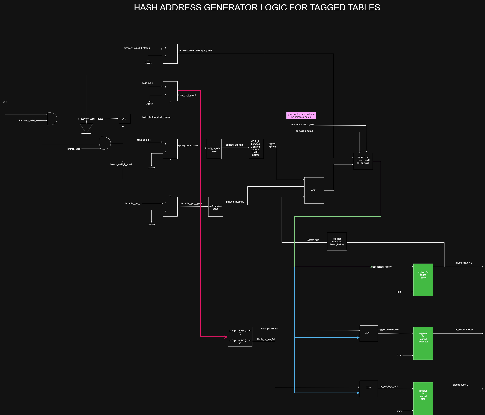
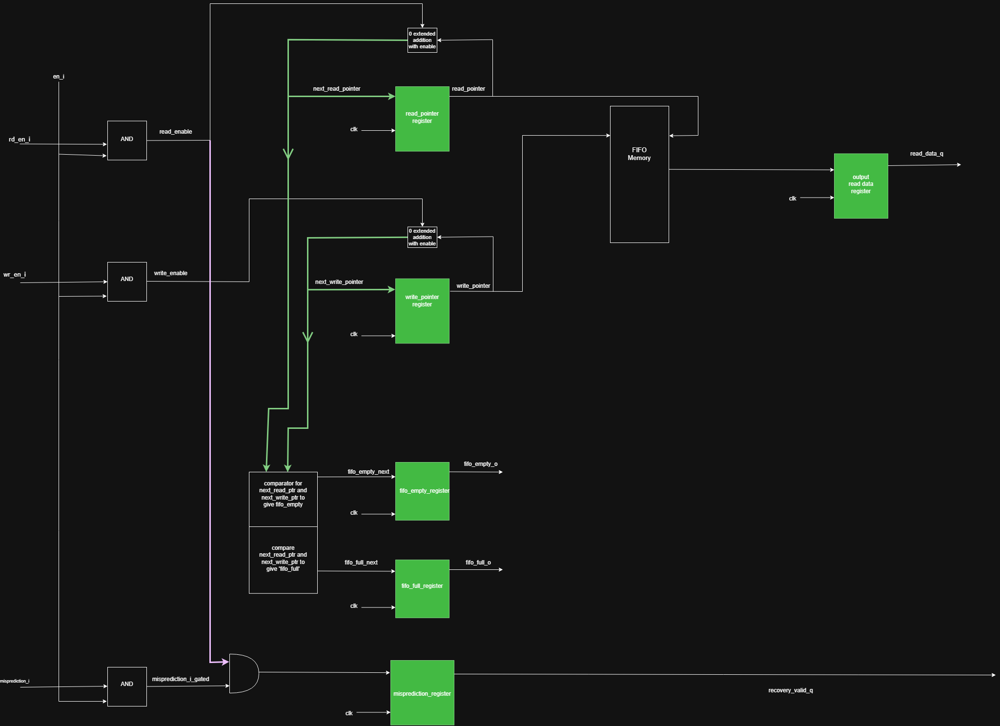

# MDP TAGE Predictor

This repository documents the design, verification, low-power implementation, and timing optimization of an MDP TAGE predictor for speculative loads at the load-store stage of a processor pipeline. 

Currently we are going block by block in the design and started with major part focused on the Global History Register (GHR): identifying its longest combinational timing path, tracing that path to the synthesized cell level, and implementing two pipelined alternatives for timing closure.


> **GHR optimization result:** the original functional input-to-output timing arc was split into registered stages. Both implemented boundaries reduced the reported pure input-to-output combinational path count to zero. Boundary 2 was subsequently confirmed in PrimeTime at a 600 MHz target clock, while Boundary 1 provided the better synthesis-stage input margin and lower area.

## Global History Register (GHR)

The GHR stores the branch-history packets used by the downstream folding and hash-generation logic. Each packet is 7 bits wide and contains branch type, taken status, and the low target-address bits.

The completed GHR implementation provides:

- 36 logical history entries arranged as 9 banks with 4 rows per bank.
- A circular 6-bit head pointer with increment, wraparound, and misprediction rollback support.
- Seven geometric-history taps at depths 2, 4, 6, 8, 12, 16, and 32.
- Independent bank write enables and clock-gating support.
- Recovery of the head pointer using the misprediction depth supplied by the ROB.
- `incoming_packet_o`, seven `expiring_packet_o` values, and a registered `output_valid_o` for downstream history folding.

### Work completed on the GHR block

- Designed the 36-entry banked history structure and its circular head-pointer behavior.
- Implemented branch insertion, pointer wraparound, misprediction rollback, and rollback with branch replacement.
- Added operand isolation and per-bank clock-gating controls for low-power operation.
- Traced the original critical path from architectural input to output through individual synthesized cells in Design Vision.
- Evaluated three possible register boundaries and implemented the two most useful candidates in RTL.
- Added `output_valid_o` as a registered interface signal so the downstream block can distinguish the cycle in which the pipelined packet outputs are valid.
- Updated the UVM reference model and sequences to account for the added address-pipeline latency.
- Ran Design Compiler synthesis at 600 MHz for both implemented boundaries.
- Ran PrimeTime analysis for Boundary 2 and quantified the remaining timing margin.
- Confirmed that both implementations removed the original pure functional input-to-output combinational path.



## Original combinational timing path

The initial implementation contained a pure combinational path from functional inputs to the output ports. The investigated worst path started at `mispredicted_table_depth_i[1]` and ended at `expiring_packet_o[2]`. The path was first identified in the timing report and then reconstructed cell by cell in Design Vision so that the register location could be selected from the actual synthesized logic rather than from RTL structure alone.

The path traversed:

1. Input gating and rollback/head-pointer selection.
2. Circular subtraction used to calculate the requested history position.
3. Absolute target-index generation.
4. Logical-index to physical bank/row decoding.
5. Selection across the 36-entry flip-flop memory structure.
6. Output qualification and the final `expiring_packet_o[2]` logic.

The Design Vision trace below shows the cell-level implementation. The early portion includes cells such as `U3573`, `U3362`, `U2395`, `U3154`, and `U2957`; the path then continues through the address-decode and wide-selection network before reaching `U3109` and `expiring_packet_o[2]`.

**Original path, part 1 — input and rollback/index logic:**



**Original path, part 2 — bank/memory selection to the output:**



The close-up below captures the beginning of the traced cone. `U3573` is a two-input NAND gate driven by `en_i` and `mispredicted_table_depth_i[1]`. Its output drives the `B` input of `U3362`; the other `U3362` input comes from the inverted `head_ptr[1]` register output through `U2307`. This is one of the points where the input-dependent rollback logic joins the registered pointer state.



This analysis showed that optimizing one gate would not address the architectural problem. The implemented solution instead breaks the input-to-output timing arc before the banked-memory selection logic and creates explicit timing boundaries for block-level budgeting.

## Evaluated pipeline boundaries

Two register locations were implemented and analyzed. Both versions remove the direct functional input-to-output combinational path, but they distribute the logic differently around the inserted registers. This provided a concrete area-versus-timing comparison rather than relying on an assumed pipeline location.

In both versions, `output_valid_o` is reset to `0` and is registered from `br_valid_and_recovery_not_active`. The expiring-packet outputs are qualified with this registered valid signal, keeping the validity indication aligned with the newly pipelined read address and preventing stale memory data from being treated as a valid output.

### Boundary 1: register the target index

Boundary 1 was implemented by registering the seven 6-bit `target_index` values after circular index calculation and before bank/row decoding. The change added 42 address-pipeline register bits.

```text
Inputs -> pointer/rollback and target-index logic -> [target_index registers]
       -> bank/row decode -> history-memory selection -> outputs
```

The resulting partition keeps the input-to-register stage shorter, while bank/row decoding and the memory-selection network remain in the register-to-output stage. This version produced the larger input-side setup margin and the smaller synthesized area of the two implementations.



RTL: [`1_LP_Global_History_register_boundary1.sv`](1_LP_Global_History_register_boundary1.sv)

### Boundary 2: register the decoded read address

Boundary 2 was implemented by moving the pipeline point after the bank and row calculations. For each of the seven history taps, a 4-bit `read_bank` and a 2-bit `read_row` are registered, again adding 42 address-pipeline register bits.

```text
Inputs -> pointer/rollback and target-index logic -> bank/row decode
       -> [read_bank/read_row registers] -> history-memory selection -> outputs
```

The resulting partition leaves substantially more timing margin after the registers, but places target-index and address-decoding logic together in the input-to-register stage. PrimeTime confirmed that this version meets the 600 MHz target, with only `0.785 ps` of setup margin remaining on its limiting input path.



RTL: [`1_LP_Global_History_register_boundary2.sv`](1_LP_Global_History_register_boundary2.sv)

## Measured timing and area results

The following results were obtained with a 600 MHz target clock (`1666.67 ps` period). Boundary 1 timing values are from the Design Compiler synthesis run. Boundary 2 timing values were confirmed with PrimeTime; area values are synthesis results.

| Metric | Boundary 1 | Boundary 2 |
|---|---:|---:|
| Pipeline location | `target_index` | `read_bank` + `read_row` |
| Added address-pipeline bits | 42 | 42 |
| Worst input-to-register setup slack | `+6.84 ps` (PT) | `+0.785 ps` (PT) |
| Worst register-to-output setup slack | `+271.45 ps` (PT) | `+599.27 ps` (PT) |
| Total synthesized cell area | `4478.28` | `4641.11` |
| Pure functional input-to-output combinational paths | `0` | `0` |

The Boundary 2 implementation uses `162.83` more units of synthesized cell area than Boundary 1, an increase of approximately `3.64%`. Both alternatives add the same 42 address-pipeline register bits; this count describes the boundary registers and excludes the common registered packet/valid interface. The area difference is therefore primarily a consequence of how the changed register location affects combinational mapping, buffering, and cell selection around the pipeline boundary.

### Engineering outcome

- The original path from `mispredicted_table_depth_i[1]` to `expiring_packet_o[2]` no longer exists as a direct combinational input-to-output path in either implementation.
- Boundary 1 retained approximately `6.06 ps` more input-stage margin and used approximately `3.64%` less synthesized cell area than Boundary 2.
- Boundary 2 created approximately `327.82 ps` more register-to-output margin, moving most of the available timing cushion to the memory-selection side of the pipeline.
- Boundary 1 emerged as the lower-area implementation with greater input-side frequency headroom.
- Boundary 2 demonstrated that the complete target-index and bank/row decode can remain in the input stage while still meeting the 600 MHz target in PrimeTime, although with very little remaining setup margin.

The study demonstrates that register placement redistributes the timing burden rather than eliminating logic delay. The reported comparison retains the distinction between synthesis and signoff analysis: Boundary 2 has a completed 600 MHz PrimeTime run, and Boundary 1 has also completed a Primetime run of 600 Mhz with some more slack cushion to counter uncertainity.


## NOW, there is one more challenge i.e. the cushion is there for the BOUNDARY 1 implementation - but what if I need increase teh frequency of the design. So, I have come up with an idea that will majorly change the design image uploaded above and will need a re-verification of the GHR block. But, one good thing with the re-architecting of this design block is that I will be able to improve the frequency of the design a lot more without worrying about the interface inputs and outputs. It also gives a leverage to add retention logic cells at input and output of the design block - inconsideration for power ON and OFF. HOPEFULLY IT WORKS.

## GHR verification

The GHR UVM environment was updated to account for the added pipeline latency. The reference model and directed sequences check normal insertion, pointer wraparound, rollback, rollback with replacement, enable gating, and all seven expiring-history outputs. Repeated rollback scenarios were also added to exercise recovery behavior across multiple pointer positions.

Testbench: [`TB_GHR - timing_boundary.sv`](Verification/Verification%20Block%20Level/GHR%20verification/TB_GHR%20-%20timing_boundary.sv)

---

## Hash Address Generator

The hash-address-generation block converts the current load PC and the maintained branch-history state into the indices and tags used to access the base and tagged predictor tables. The implementation separates the direct-mapped base-table calculation from seven parallel tagged-table hash engines.

### Block organization

- The base-table index is taken from the word-aligned load PC. With the default 10-bit base index, the block registers `load_pc_i[11:2]`.
- Seven tagged-table engines correspond to geometric history depths 2, 4, 6, 8, 12, 16, and 32.
- Each tagged engine maintains a 23-bit folded-history state, formed from the default 7-bit index width and 16-bit tag width.
- The incoming 7-bit GHR packet is zero-extended and XORed into the folded history.
- The packet expiring from each geometric-history window is zero-extended, rotated according to `DEPTHS[i] % CSR_WIDTH`, and XORed out of the folded state.
- Separate PC mixing functions are used for the tagged-table index and tag:
  - Index mix: `pc_word ^ (pc_word >> 2) ^ (pc_word >> 5)`.
  - Tag mix: `pc_word ^ (pc_word >> 3) ^ (pc_word >> 7)`.
- The final tagged index and tag are produced by XORing the relevant folded-history bits with the corresponding PC hash.

The normal folded-history update performed for each tagged table is:

```text
next_folded_history = rotate_left(folded_history, 1)
                      XOR padded_incoming_packet
                      XOR depth_aligned_expiring_packet
```

### Recovery and low-power behavior

Normal branch folding and checkpoint recovery share the same registered folded-history state. A valid recovery has priority over a normal branch update: the checkpointed folded-history vector from the FIFO is loaded directly into the seven folding engines, after which the table indices and tags are regenerated from the restored history and the load PC.

The implementation also includes operand isolation and clock-enable generation:

- `br_valid_i_gated` allows normal folding only when the block is enabled and recovery is inactive.
- `recovery_valid_i_gated` qualifies restoration data from the checkpoint FIFO.
- `folded_history_clock_en` is asserted for either a valid branch update or a valid recovery.
- The registered `valid_o` indicates when the folded-history and hashed table outputs correspond to an accepted operation.
- `folded_history_o` exposes the maintained state so it can be checkpointed for later misprediction recovery.



RTL: [`2_LP_Hash_and_fold_logic.sv`](2_LP_Hash_and_fold_logic.sv)

Verification plan: [`Tagged HASH address generator verification plan`](Verification/Verification%20Block%20Level/Tagged%20HASH%20address%20generator/Verification%20plan.docx)

---

## Checkpoint FIFO Buffer

The checkpoint FIFO preserves speculative folded-history states so that the hash-address-generation block can restore a known-good history after a branch misprediction. With the default parameters, the FIFO contains 16 entries; every entry stores seven 23-bit folded-history values, for a total checkpoint payload of 161 bits per entry.

### FIFO operation

- Independent read and write pointers select the checkpoint to restore and the location for the next speculative snapshot.
- Each pointer contains an extra wrap bit. Equal complete pointers indicate empty, while equal address bits with different wrap bits indicate full.
- A write is accepted only when the block is enabled and the FIFO has space.
- When the FIFO is full, a write can still be accepted if a read is accepted in the same cycle.
- A read is accepted only when the block is enabled and the FIFO is not empty.
- Separate read and write clock-gating enables prevent inactive pointer and memory operations from toggling.
- The synchronous read path captures all seven folded-history values in `read_data_q` before advancing the read pointer.
- Registered `fifo_full_o` and `fifo_empty_o` flags are calculated from the next pointer values so simultaneous operations are represented correctly.

### Misprediction recovery interface

The FIFO does not continuously expose arbitrary memory contents as valid recovery state. A recovery transaction requires an accepted read together with a qualified misprediction. The read checkpoint is first captured in the output register, and `recovery_valid_o` then qualifies the restored seven-entry folded-history vector for the downstream hash block.

This creates a defined recovery boundary between the two blocks:

```text
Speculative branch updates
        -> save folded_history_o in checkpoint FIFO
        -> misprediction selects and reads the required checkpoint
        -> recovery_valid_o qualifies recovery_folded_history_o
        -> hash engines reload the unstale folded-history state
```

When `recovery_valid_o` is low, the recovery data outputs are driven to zero so inactive FIFO data is not interpreted as a valid restore operation.



RTL: [`17_checkpoint_fifo_buffer.sv`](17_checkpoint_fifo_buffer.sv)

Verification: [`TB_checkpoint_fifo.sv`](Verification/TB_checkpoint_fifo.sv)

Integrated GHR/FIFO/hash verification: [`GHR_HASH_Address_CHECKPT_FIFO verification`](Verification/Verification%20Block%20Level/GHR_HASH_Address_CHECKPT_FIFO%20verification/)
