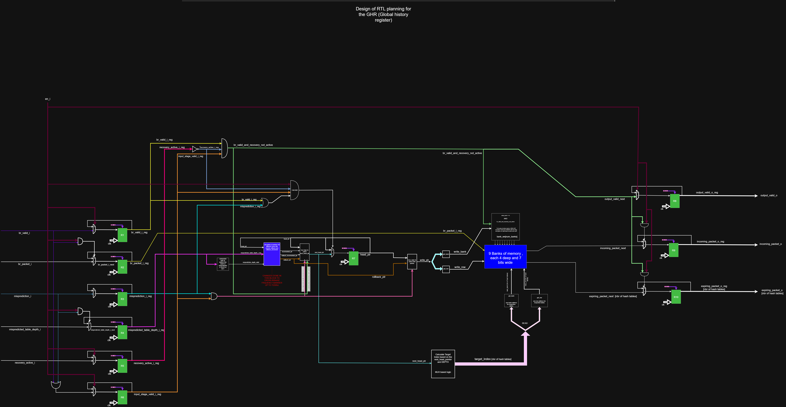
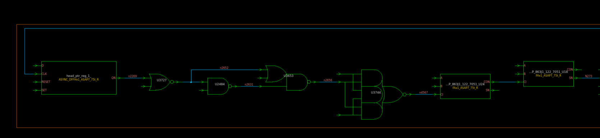
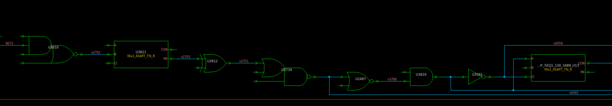
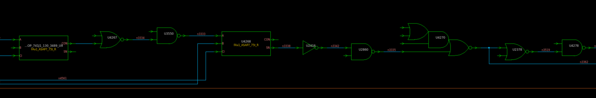
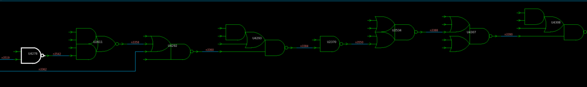
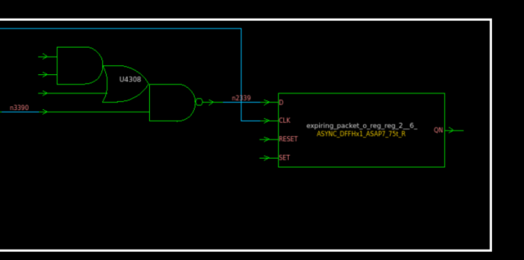

# GHR registered-I/O timing-closure log

This document records the engineering decisions, functional issues, verification work, synthesis results, PrimeTime results, and remaining timing work for the registered-input/registered-output Global History Register. It is a record of the implemented work rather than an instruction to redesign the block.

## 1. Motivation and architectural change

The earlier GHR timing study inserted an internal register at either target_index or read_bank/read_row. Those boundary experiments removed the original pure input-to-output combinational path, but they distributed timing margin unevenly and changed the latency inside the read-address path.

A separate registered-I/O version was therefore developed. Functional inputs are captured at the block boundary, the internal GHR operation is performed from registered state, and incoming_packet_o, expiring_packet_o, and output_valid_o are captured before leaving the block. This gives the block explicit timing boundaries, simplifies integration timing budgets, and provides natural locations for future isolation or retention logic.

The principal registers are:

| Label | RTL state |
|---|---|
| R1 | br_valid_i_reg |
| R2 | br_packet_i_reg[6:0] |
| R3 | misprediction_i_reg |
| R4 | mispredicted_table_depth_i_reg[5:0] |
| R5 | recovery_active_i_reg |
| R6 | input_stage_valid_reg |
| R7 | head_ptr[5:0] |
| R8 | output_valid_o_reg |
| R9 | incoming_packet_o_reg[6:0] |
| R10 | expiring_packet_o_reg[0:6][6:0] |



## 2. Functional and verification issues encountered

### 2.1 Enable bubbles and pointer progression

Alternating enable sequences exposed a control-alignment problem. When en_i was low between accepted transactions, combinational next_head_ptr logic could fall back to the current head_ptr while a previously accepted operation was still moving through the registered pipeline. The next active edge could therefore retain an old pointer value and later writes appeared to skip or overwrite history positions.

The correction was to treat pointer movement as part of the accepted transaction. The pointer update, write address, write enable, and registered packet data must all describe the same operation. Alternating-enable and two-enabled/one-disabled sequences were used specifically to expose this condition.

### 2.2 Memory write control and registered packet data

A second failure occurred when the bank-memory write condition used raw branch-valid control while the memory data came from br_packet_i_reg. That combined control from one transaction with data from another transaction. It was especially visible in back-to-back rollback and replacement traffic.

The memory write qualification was aligned with the registered branch transaction. Address, enable, and packet data are now evaluated from one pipeline stage. This eliminated missing writes and the delayed accumulation of packet values in later cycles.

### 2.3 Incoming and expiring packet alignment

The downstream folding logic consumes incoming_packet_o and the seven expiring packets as one logical update. The testbench therefore checks them together with output_valid_o. During development, the expiring path initially appeared later because it includes target-index calculation, bank/row translation, memory selection, and output registration. The control/data pipeline was adjusted so that the incoming packet, expiring packet bundle, and valid indication refer to the same accepted branch.

### 2.4 Scoreboard pointer reference

The original reference calculation used next_head_ptr when determining the expected expiring packet. That produced an off-by-one history interpretation. If the current free head is pointer 3, depth 2 corresponds to pointer 1 under a conventional distance calculation; the scoreboard must use the same architectural reference point and pipeline cycle as the RTL. The reference model was updated to model accepted operations and delayed outputs explicitly instead of comparing every output to same-cycle raw inputs.

### 2.5 Reset and startup X values

The first monitor samples occurred before reset had initialized the asynchronous registers, producing X mismatches at time zero. Reset-directed testing now asserts active-low reset, checks asynchronous clearing, holds reset across clock edges, deasserts it between edges, and verifies that operation restarts from pointer zero.

### 2.6 Bank clock behavior

The per-bank gated clocks are expected to be zero whenever that bank is not selected for a valid write. Seeing all gated_bank_clk values low in the middle of stimulus is not automatically a failure; it is correct when no bank write is accepted. The important check is that exactly the selected bank receives a write edge and that its address, data, and enable belong to the same registered transaction.

### 2.7 Illegal rollback-depth stimulus

The final multi-sequence regression reported illegal registered misprediction depth zero during rollback-focused sequences. Depth zero is outside the legal rollback protocol used by the design. The errors were traced to stimulus/scoreboard protocol handling rather than the legal GHR datapath. This case is parked as an illegal-input test: legal functional timing work proceeds with rollback depth in the range 1 through 35, while a later negative test can define the desired response to depth zero explicitly.

## 3. Timing-path improvement

### 3.1 Original registered-I/O limiting arithmetic

The first registered-I/O implementation calculated rollback_ptr and then calculated rollback_incremented_ptr in a second dependent step. In the rollback-plus-valid-branch mode, this created serial arithmetic before the target-index, address-decode, and memory-selection logic.

At 600 MHz, the pre-optimization head-pointer-to-expiring path had:

| Measurement | Value |
|---|---:|
| Data arrival | 1605.8624 ps |
| Setup slack | +48.2930 ps |

### 3.2 Direct rollback-plus-increment calculation

The rollback-plus-increment result was reformulated as a direct extended-width operation equivalent to:

head_ptr + 1 - mispredicted_table_depth, modulo 36.

rollback_ptr remains available for rollback-only behavior and write-address selection. The direct expression removes the dependency in which an incrementer waits for rollback subtraction to finish.

After synthesis and PrimeTime analysis at 600 MHz:

| Measurement | Before | After | Improvement |
|---|---:|---:|---:|
| Head-pointer-to-expiring arrival | 1605.8624 ps | 1377.3075 ps | 228.5549 ps |
| Setup slack | +48.2930 ps | +276.8159 ps | +228.5229 ps |
| Path-delay reduction | — | — | approximately 14.25% |

The overall worst 600 MHz path then moved to raw en_i control feeding an expiring output register. That path arrived at 1439.5693 ps and retained +214.5541 ps of setup slack. Its large control nets had fanouts of 57 and 64.

## 4. 600 MHz implementation summary

| Metric | Registered-I/O GHR |
|---|---:|
| Clock period | 1666.67 ps |
| Worst setup slack after arithmetic optimization | +214.5541 ps overall |
| Worst hold slack | +11.9252 ps |
| Sequential cells | 332 |
| Total cell area | 5015.2867 |
| Estimated synthesis power | 0.261 mW |
| Direct functional input-to-output paths | 0 |
| Setup violations | 0 |
| Hold violations | 0 |

## 5. 700 MHz timing closure

The same RTL was synthesized again using a 1428.571 ps clock period. PrimeTime reproduced the Design Compiler result closely.

| Metric | 700 MHz result |
|---|---:|
| Clock period | 1428.571 ps |
| Worst setup startpoint | head_ptr_reg_1_ |
| Worst setup endpoint | expiring_packet_o_reg_reg_2__6_ |
| Data arrival | 1374.0164 ps |
| Data required | 1416.0233 ps |
| Worst setup slack | +42.0069 ps |
| Worst hold slack | +11.9252 ps |
| Worst input-to-register slack | +119.3126 ps |
| Worst register-to-output slack | +736.2537 ps |
| Total cell area | 5014.5869 |
| Estimated synthesis power | 0.303 mW |
| Direct functional input-to-output paths | 0 |
| Setup/hold violations | 0 / 0 |

The timing-equivalent minimum period estimated from this mapping is approximately 1386.563 ps, corresponding to about 721.2 MHz. A 720 MHz run would therefore have only about 2.3 ps of nominal margin if the mapping remained unchanged. This estimate is useful for characterization, but it is not a robust signoff target because clock uncertainty, extracted interconnect, variation, and physical implementation margin are not yet included.

## 6. Current limiting path

The current path is:

head_ptr_reg[1] -> pointer/next-head arithmetic -> target_index[2] for depth 6 -> read-bank/read-row decode -> 9-bank by 4-row history selection -> expiring_packet_o_reg[2][6].

The path contains two synthesized arithmetic groups, address decoding, high-fanout intermediate nets, and the memory-read selection tree. The largest observed local increments include:

| Cell/net | Observation |
|---|---|
| U4278 driving n3542 | 113.1472 ps, fanout 30 |
| U3734 driving n4302 | 85.4915 ps, fanout 17 |
| U2378 | 71.5585 ps |
| U2467 | 67.9924 ps |
| DP_OP_863...U18/SN | 58.5042 ps |
| U2370 | 58.9674 ps |

The DP_OP cells are Design Compiler datapath operators. FAx1 cells expose A, B, and CI inputs and inverted carry/sum outputs CON and SN. Consecutive CON-to-CI connections identify carry propagation; an SN endpoint represents the inverted sum result used by downstream logic.







The next optimization step is deliberately not chosen from gate delay alone. The synthesized target_index[2] boundary is being located in Design Vision so the delay can be separated into pointer arithmetic, target-index arithmetic, bank/row decoding, and memory selection before another RTL change is made.

### 6.1 Confirmed critical-path partition

Design Vision connectivity tracing separated the 700 MHz path into the following functional sections. The combinational delay excludes the 77.4716 ps clock-to-Q delay of head_ptr_reg[1].

| Section | Function | Measured delay | Share of combinational delay |
|---|---|---:|---:|
| A | Pointer calculation and next-head-pointer selection | 458.7063 ps | 35.4% |
| B | target_index[2] arithmetic for history depth 6 | 336.2113 ps | 25.9% |
| C | Bank/row decoding and select distribution | 264.4337 ps | 20.4% |
| D | Bank-memory data mux and output logic | 237.1933 ps | 18.3% |

Sections A and B together consume 794.9176 ps, or approximately 61.3% of the combinational path. The A/B boundary is the high-fanout n4302 node driven by U3734/Y. The B/C boundary is n3338, the U4268/SN full-adder output that divides into the bank and row decoding cones. The C/D boundary is n3542, the final decoded selection term driven by U4278/Y.

Section C is:

```text
n3338 -> U2416 -> U2860 -> U4270 -> U2378 -> U4278 -> n3542
```

U4278 is a NAND2xp5 cell driving 30 loads. It contributes 113.1473 ps and produces a 199.6314 ps output transition. Its load set consists primarily of OAI22/AOI22 memory-selection gates, confirming that n3542 is a shared bank/row selection signal rather than stored packet data.

Section D is:

```text
n3542
  -> U2611/B2  (AOI22xp33, 41.6407 ps)
  -> U4292/A2  (OAI31xp33, 28.1354 ps)
  -> U4293/C   (A2O1A1Ixp33, 29.7069 ps)
  -> U2370/B   (NAND2xp33, 58.9673 ps)
  -> U2534/B2  (OAI22xp33, 27.4343 ps)
  -> U4307/A3  (OAI32xp33, 26.1658 ps)
  -> U4308/C   (A2O1A1Ixp33, 25.1429 ps)
  -> expiring_packet_o_reg[2][6]/D
```

U2611 implements the first memory-data selection term. Its critical inputs are C1_DATA1_1 on B1 and the decoded n3542 select on B2; n3348 and n3544 form the competing AOI22 term.

### 6.2 Drive-strength timing note

Cell drive strength describes the current capability of a standard cell's output stage. In this ASAP7 NAND2 family, the approximate strength order is xp33, xp5, xp67, x1, x1p5, and x2. A stronger cell has lower effective output resistance and therefore charges or discharges a capacitive load faster. A first-order interpretation is cell delay proportional to output resistance multiplied by load capacitance.

Upsizing a cell can reduce its output transition and downstream arrival time, but it also increases the cell's input capacitance. The preceding gate must then drive a larger load. Stronger cells also generally increase area, leakage, and internal switching capacitance, and a faster minimum-delay path can reduce hold margin. Consequently, the full timing path, area, power, and hold result must be compared rather than judging only the resized cell's local delay.

For U4278, upsizing should improve its ability to drive the 30 memory-mux loads, while increasing the load presented to U2378. A temporary Design Vision change from NAND2xp5 to NAND2x1 is therefore used only as a controlled in-memory experiment. The saved DDC and RTL remain unchanged until the total-path benefit and tradeoffs are measured.
### 6.3 Temporary U4278 drive-strength experiment

U4278 was initially resized as an in-memory Design Vision experiment from NAND2xp5 to NAND2x1. After the result was accepted, the change was added to the post-compile sizing ECO described in Section 6.5. After `update_timing`, the worst path to expiring_packet_o_reg[2][6] improved as follows:

| Measurement | Original mapping | U4278 resized |
|---|---:|---:|
| Data arrival | 1374.0162 ps | 1354.6036 ps |
| Setup slack | +42.0071 ps | +61.4197 ps |
| End-to-end improvement | — | 19.4126 ps |

The reported critical path no longer passed through U4278/n3542. It migrated to the parallel n3544 selection branch through U2859, U2846, U3732, and U4277. U4277 is also a NAND2xp5 cell driving 30 loads; it contributed 110.1544 ps and produced a 199.0981 ps transition. The path then entered U2611 through A2 instead of through the original n3542/B2 term.

This migration demonstrates that the memory read is implemented by multiple nearly balanced high-fanout decode branches. Strengthening only U4278 improves timing, but another equivalent branch becomes limiting. A durable implementation should therefore consider the complete family of high-fanout bank/row decode signals, synthesis transition/fanout constraints, or a buffered decode structure rather than treating U4278 as an isolated RTL problem.

### 6.4 Manual sizing of the U3908 path

The next detailed study locked the following route so that Design Compiler did not substitute a different internal branch having the same register endpoints:

```text
head_ptr_reg_1_/QN
  -> U3734/Y, n4302 fanout 17
  -> U3733/Y, n3063 fanout 10
  -> U3908/Y, n3089 fanout 30
  -> U2373/Y, n3095 fanout 7
  -> expiring_packet_o_reg_reg_0__0_/D
```

Using only `-from` and `-to` was insufficient for controlled comparison because several combinational routes connect the same registers. After one route became faster, `report_timing` selected a parallel route containing fanout-29 and fanout-28 nets. The controlled reports therefore used explicit `-through` points for U3734, U3908, and later U2373.

The accepted cell-size changes are:

| Cell | Original | Accepted | Reason |
|---|---|---|---|
| U3908 | NAND2x1 | NAND2x1p5 | Improved drive of the fanout-30 n3089 net |
| U3733 | NOR2xp33 | NOR2xp67 | Recovered the U3908 input-capacitance penalty and improved n3063 slew |
| U3734 | OAI21xp5 | OAI21x1 | Improved the fanout-17 n4302 transition |
| U3726 | NOR2xp33 | NOR2xp67 | Improved a 6.0915-capacitance, fanout-4 net and the downstream inverter |
| U2467 | NOR2xp33 | NOR2xp67 | Reduced its own delay and improved U3589 input slew |
| U3589 | NAND2xp33 | NAND2xp5 | Improved U3726 input slew with no measured cell-area increase |
| U2373 | NAND2xp33 | NAND2xp5 | Improved the fanout-7 n3095 transition with no measured cell-area increase |

Key controlled experiments were:

| Experiment | Path arrival | Slack | Timing gain | Total cell area | Area change |
|---|---:|---:|---:|---:|---:|
| After U3734/U3733/U3908 sizing | 1238.9390 ps | 177.0844 ps | reference | 5018.552648 | reference |
| Add U3726xp67 | 1204.6016 ps | 211.4218 ps | 34.3374 ps | 5018.552648 | 0 |
| U2467xp67 only, after U3726 | 1190.9958 ps | 225.0275 ps | 13.6058 ps | 5019.019208 | +0.466560 |
| U3589xp5 only, after U3726 | 1195.8313 ps | 220.1920 ps | 8.7703 ps | 5018.552648 | 0 |
| U2467xp67 and U3589xp5 | 1182.4242 ps | 233.5991 ps | 22.1774 ps | 5019.019208 | +0.466560 |
| Add U2373xp5 | 1160.2734 ps | 255.7499 ps | 22.1508 ps | 5019.019208 | 0 |

The combined U2467/U3589 improvement was nearly additive: the separate gains summed to 22.3761 ps and the combined measured gain was 22.1774 ps. U2373xp5 reduced its own delay from 49.0334 ps to 30.5790 ps and improved its output transition from 87.1396 ps to 46.0851 ps. Its predecessor U2389 incurred only a 1.9591 ps delay penalty.

These changes are post-compile mapped-cell ECOs rather than RTL architectural modifications. They are reproduced by `scripts/ghr/ghr_2reg_700mhz_manual_sizing_eco.tcl`, sourced immediately after `compile_ultra`. The ECO script fails if a required mapped instance or library cell is missing, because generated U-number instance names can change when RTL, constraints, libraries, or the synthesis version change. Accepted cells are marked `dont_touch` after sizing so a later incremental optimization does not silently resize them.

#### 6.4.1 Measurement method

Each sizing decision used the same sequence:

1. Keep the startpoint, endpoint, and required `-through` cells fixed.
2. Record the predecessor-cell delay and transition before resizing.
3. Resize exactly one cell unless the experiment explicitly tests a combination.
4. Run `update_timing` without recompiling the netlist.
5. Record the resized-cell delay, output transition, downstream-cell effects, endpoint arrival, and slack.
6. Run `report_area` and compare total cell area.
7. Keep the change only when the complete-path benefit outweighed its predecessor penalty and area cost.

This distinction is important because a stronger cell has greater input capacitance. A local cell-delay reduction is not sufficient evidence: its predecessor can become slower, and another parallel route can become the new limiting route.

#### 6.4.2 U3908: drive the fanout-30 n3089 net

U3908 was changed from NAND2x1 to NAND2x1p5. The stronger input capacitance increased the n3063 load seen by U3733, but it substantially improved the transition delivered to the 30 loads on n3089.

| Measurement | U3908x1 | U3908x1p5 | Change |
|---|---:|---:|---:|
| n3063 capacitance | 4.7320 | 5.2393 | +0.5073 |
| U3733 delay | 55.8629 ps | 60.8232 ps | +4.9603 ps |
| U3733 output transition | 100.7210 ps | 110.4547 ps | +9.7337 ps |
| U3908 delay | 87.4867 ps | 68.5869 ps | -18.8998 ps |
| U3908 output transition | 133.2326 ps | 93.4924 ps | -39.7402 ps |
| U2553 delay | 28.8574 ps | 25.2426 ps | -3.6148 ps |
| Endpoint arrival | 1342.0205 ps | 1322.9061 ps | -19.1144 ps |
| Path slack | 74.0028 ps | 93.1172 ps | +19.1144 ps |

Decision: accept U3908x1p5. The 4.9603 ps predecessor penalty was outweighed by the U3908 and downstream improvements.

#### 6.4.3 U3733: recover the U3908 input-load penalty

U3733 was changed from NOR2xp33 to NOR2xp67. The larger U3733 input increased the load on U2801, but it improved both its own fanout-10 output and the input slew seen by U3908.

| Measurement | U3733xp33 | U3733xp67 | Change |
|---|---:|---:|---:|
| U3733 input-net capacitance | 0.3428 | 0.6903 | +0.3475 |
| U2801 delay | 19.0338 ps | 23.5619 ps | +4.5281 ps |
| U3733 delay | 60.8232 ps | 37.4639 ps | -23.3593 ps |
| U3733 output transition | 110.4547 ps | 62.6926 ps | -47.7621 ps |
| U3908 delay | 68.5869 ps | 54.4194 ps | -14.1675 ps |
| Endpoint arrival | 1322.9061 ps | 1289.9075 ps | -32.9986 ps |
| Path slack | 93.1172 ps | 126.1158 ps | +32.9986 ps |

Decision: accept U3733xp67. It compensated for the U3908 input capacitance and generated an additional downstream gain.

#### 6.4.4 U3734: drive the fanout-17 n4302 net

U3734 was changed from OAI21xp5 to OAI21x1. Its input capacitance approximately doubled, slightly slowing U3812, but its fanout-17 output transition improved by more than 75 ps.

| Measurement | U3734xp5 | U3734x1 | Change |
|---|---:|---:|---:|
| n2721 capacitance | 0.5686 | 1.1405 | +0.5719 |
| U3812 delay | 24.3759 ps | 26.8708 ps | +2.4949 ps |
| U3812 output transition | 23.6769 ps | 29.8951 ps | +6.2182 ps |
| U3734 delay | 85.4915 ps | 52.2063 ps | -33.2852 ps |
| U3734 output transition | 164.8443 ps | 89.5925 ps | -75.2518 ps |
| Endpoint arrival | 1289.9075 ps | 1238.9390 ps | -50.9685 ps |
| Path slack | 126.1158 ps | 177.0844 ps | +50.9686 ps |

Decision: accept U3734x1. The predecessor penalty was small compared with the direct and propagated improvements.

#### 6.4.5 U3726: improve the n4566 drive and downstream inverter

U3726 was changed from NOR2xp33 to NOR2xp67. The n2722 load on U3589 increased, but U3726 and its downstream inverter both became faster.

| Measurement | U3726xp33 | U3726xp67 | Change |
|---|---:|---:|---:|
| n2722 capacitance | 0.3428 | 0.6903 | +0.3475 |
| U3589 delay | 22.6797 ps | 28.8242 ps | +6.1445 ps |
| U3589 output transition | 47.9270 ps | 60.0266 ps | +12.0996 ps |
| U3726 delay | 77.5692 ps | 51.2617 ps | -26.3075 ps |
| U3726 output transition | 134.8564 ps | 81.7476 ps | -53.1088 ps |
| U3817 delay | 48.8340 ps | 38.5978 ps | -10.2362 ps |
| Endpoint arrival | 1238.9390 ps | 1204.6016 ps | -34.3374 ps |
| Path slack | 177.0844 ps | 211.4218 ps | +34.3374 ps |

Decision: accept U3726xp67. The complete path improved by 34.3374 ps despite the U3589 penalty.

#### 6.4.6 Controlled U2467 and U3589 sizing matrix

U2467 and U3589 were tested separately and together. This avoided attributing a combined result to the wrong cell.

| Configuration | Endpoint arrival | Timing gain from 1204.6016 ps | Total cell area | Area change |
|---|---:|---:|---:|---:|
| Both original: U2467xp33, U3589xp33 | 1204.6016 ps | reference | 5018.552648 | reference |
| U2467xp67 only | 1190.9958 ps | 13.6058 ps | 5019.019208 | +0.466560 |
| U3589xp5 only | 1195.8313 ps | 8.7703 ps | 5018.552648 | 0 |
| U2467xp67 and U3589xp5 | 1182.4242 ps | 22.1774 ps | 5019.019208 | +0.466560 |

The separate improvements summed to 22.3761 ps; the combined measurement was 22.1774 ps. The 0.1987 ps difference shows that the changes were almost additive. U3589xp5 had the same reported physical cell area as U3589xp33 in this library.

Decision: accept both U2467xp67 and U3589xp5. The combined configuration had the best timing, and its entire area cost came from U2467.

#### 6.4.7 U2373: drive the fanout-7 n3095 net

U2373 was changed from NAND2xp33 to NAND2xp5. The larger input increased the n2929 load on U2389, but U2373 and U2525 both became faster.

| Measurement | U2373xp33 | U2373xp5 | Change |
|---|---:|---:|---:|
| n2929 capacitance | 0.8591 | 1.0364 | +0.1773 |
| U2389 delay | 23.6051 ps | 25.5642 ps | +1.9591 ps |
| U2389 output transition | 25.8961 ps | 28.8914 ps | +2.9953 ps |
| U2373 delay | 49.0334 ps | 30.5790 ps | -18.4544 ps |
| U2373 output transition | 87.1396 ps | 46.0851 ps | -41.0545 ps |
| U2525 delay | 27.0728 ps | 21.6974 ps | -5.3754 ps |
| Endpoint arrival | 1182.4242 ps | 1160.2734 ps | -22.1508 ps |
| Path slack | 233.5991 ps | 255.7499 ps | +22.1508 ps |
| Total cell area | 5019.019208 | 5019.019208 | 0 |

Decision: accept U2373xp5. It provided 22.1508 ps of additional path improvement with no measured area increase.

#### 6.4.8 Cumulative result and interpretation

Across the accepted U3908-path sizing sequence, the endpoint arrival improved from 1342.0205 ps to 1160.2734 ps, a cumulative reduction of 181.7471 ps. Slack improved from 74.0028 ps to 255.7499 ps. This cumulative number must not be interpreted as a new whole-design WNS until a fresh unrestricted `report_timing -max_paths 1` is run, because another path can become globally limiting.

The final accepted cells for this route are:

```text
U3734 = OAI21x1
U2467 = NOR2xp67
U3589 = NAND2xp5
U3726 = NOR2xp67
U3733 = NOR2xp67
U3908 = NAND2x1p5
U2373 = NAND2xp5
```

### 6.5 Reproducing and preserving the mapped-cell choices

The accepted changes are implemented by `scripts/ghr/ghr_2reg_700mhz_manual_sizing_eco.tcl`. The synthesis script sources it after `compile_ultra` and before final checks, reports, and netlist writes. Applying the ECO before `compile_ultra` would not preserve the choices because compile optimization is free to remap the cells.

The ECO deliberately checks that each generated instance name resolves to exactly one cell and that every requested library cell exists. It stops the run if the mapping changes. This is necessary because names such as U3734 and U3908 are generated netlist names, not stable RTL instance names.

After sizing, the accepted cells are marked `dont_touch` and timing is updated. The resulting DDC is the reopenable mapped checkpoint; the ECO Tcl file is the reproducible record of how that checkpoint was produced. If RTL, SDC constraints, library revisions, or the synthesis tool version changes, the mapping must be re-characterized instead of blindly renaming new cells to match this list.
## 7. Constraints and signoff caveats

The 700 MHz run uses 60% of the period as maximum input delay and 40% as maximum output delay. No clock uncertainty is currently applied. rst_n is an asynchronous reset and is false-pathed from synchronous data-path analysis.

PrimeTime analysis coverage reports 664 of 2656 setup checks and 664 of 2656 hold checks as tested. The untested checks are primarily constant-disabled asynchronous reset/preset, recovery, removal, and pulse-width arcs. This does not invalidate the reported synchronous critical path, but reset recovery/removal must be handled separately before physical signoff.

## 8. Reproducible artifacts

- RTL: Verification/Verification Block Level/GHR_2reg/1_LP_Global_Histroy_register_2reg.sv
- UVM testbench: Verification/Verification Block Level/GHR_2reg/TB_GHR_2reg.sv
- Verification plan: Verification/Verification Block Level/GHR_2reg/verification plan doc.docx
- 700 MHz SDC: constraints/ghr/LP_ghr_block_2reg_700mhz.sdc
- Design Compiler script: scripts/ghr/synthesize_ghr_2reg_700mhz.tcl
- PrimeTime script: scripts/ghr/primetime_ghr_2reg_700mhz.tcl
- PrimeTime reports: reports/ghr/primetime_2reg_700mhz/
- DC report summary: reports/ghr/dc_2reg_700mhz/README.md

The scripts expect the ASAP7 .db libraries under lib/asap7_db. The Design Compiler script reads the registered-I/O RTL from the repository verification directory and writes the synthesized netlist under netlist; the PrimeTime script consumes that netlist and generated SDC.
