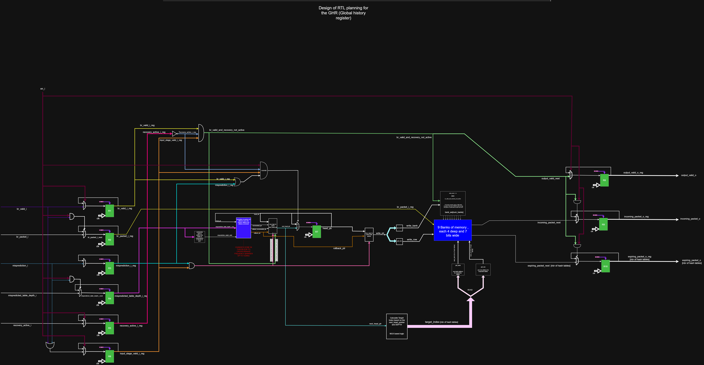
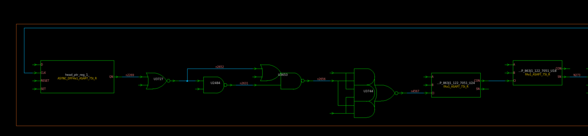
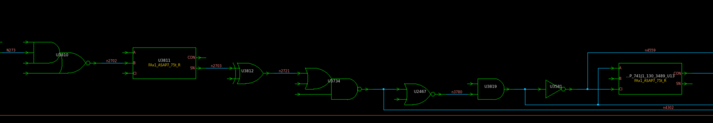
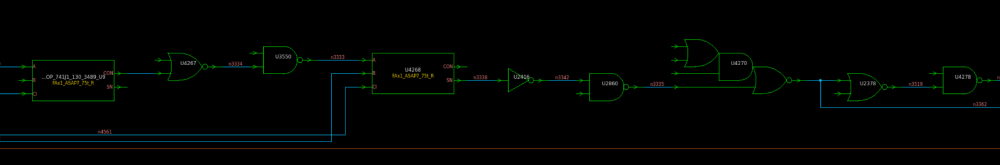
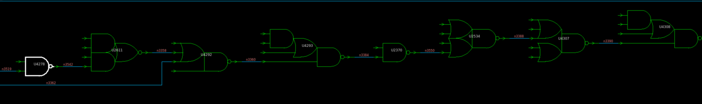
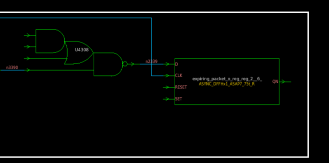

# GHR registered-I/O timing-closure log

This document records the engineering decisions, functional issues, verification work, synthesis results, PrimeTime results, and remaining timing work for the registered-input/registered-output Global History Register. It is a record of the implemented work rather than an instruction to redesign the block.

## 1. Motivation and architectural change

The earlier GHR timing study inserted an internal register at either target_index or read_bank/read_row. Those boundary experiments removed the original pure input-to-output combinational path, but they distributed timing margin unevenly and changed the latency inside the read-address path.

A separate registered-I/O version was therefore developed. Functional inputs are captured at the block boundary, the internal GHR operation is performed from registered state, and incoming_packet_o, expiring_packet_o, and output_valid_o are captured before leaving the block. This gives the block explicit timing boundaries, simplifies integration timing budgets, and provides natural locations for future isolation or retention logic.

The principal registers are:

| Label | RTL state |
|---|---|
| R1 | br_valid_i_reg |
| R2 | br_packet_i_reg[6:0] |
| R3 | misprediction_i_reg |
| R4 | mispredicted_table_depth_i_reg[5:0] |
| R5 | recovery_active_i_reg |
| R6 | input_stage_valid_reg |
| R7 | head_ptr[5:0] |
| R8 | output_valid_o_reg |
| R9 | incoming_packet_o_reg[6:0] |
| R10 | expiring_packet_o_reg[0:6][6:0] |

## 2. Functional and verification issues encountered

### 2.1 Enable bubbles and pointer progression

Alternating enable sequences exposed a control-alignment problem. When en_i was low between accepted transactions, combinational next_head_ptr logic could fall back to the current head_ptr while a previously accepted operation was still moving through the registered pipeline. The next active edge could therefore retain an old pointer value and later writes appeared to skip or overwrite history positions.

The correction was to treat pointer movement as part of the accepted transaction. The pointer update, write address, write enable, and registered packet data must all describe the same operation. Alternating-enable and two-enabled/one-disabled sequences were used specifically to expose this condition.

### 2.2 Memory write control and registered packet data

A second failure occurred when the bank-memory write condition used raw branch-valid control while the memory data came from br_packet_i_reg. That combined control from one transaction with data from another transaction. It was especially visible in back-to-back rollback and replacement traffic.

The memory write qualification was aligned with the registered branch transaction. Address, enable, and packet data are now evaluated from one pipeline stage. This eliminated missing writes and the delayed accumulation of packet values in later cycles.

### 2.3 Incoming and expiring packet alignment

The downstream folding logic consumes incoming_packet_o and the seven expiring packets as one logical update. The testbench therefore checks them together with output_valid_o. During development, the expiring path initially appeared later because it includes target-index calculation, bank/row translation, memory selection, and output registration. The control/data pipeline was adjusted so that the incoming packet, expiring packet bundle, and valid indication refer to the same accepted branch.

### 2.4 Scoreboard pointer reference

The original reference calculation used next_head_ptr when determining the expected expiring packet. That produced an off-by-one history interpretation. If the current free head is pointer 3, depth 2 corresponds to pointer 1 under a conventional distance calculation; the scoreboard must use the same architectural reference point and pipeline cycle as the RTL. The reference model was updated to model accepted operations and delayed outputs explicitly instead of comparing every output to same-cycle raw inputs.

### 2.5 Reset and startup X values

The first monitor samples occurred before reset had initialized the asynchronous registers, producing X mismatches at time zero. Reset-directed testing now asserts active-low reset, checks asynchronous clearing, holds reset across clock edges, deasserts it between edges, and verifies that operation restarts from pointer zero.

### 2.6 Bank clock behavior

The per-bank gated clocks are expected to be zero whenever that bank is not selected for a valid write. Seeing all gated_bank_clk values low in the middle of stimulus is not automatically a failure; it is correct when no bank write is accepted. The important check is that exactly the selected bank receives a write edge and that its address, data, and enable belong to the same registered transaction.

### 2.7 Illegal rollback-depth stimulus

The final multi-sequence regression reported illegal registered misprediction depth zero during rollback-focused sequences. Depth zero is outside the legal rollback protocol used by the design. The errors were traced to stimulus/scoreboard protocol handling rather than the legal GHR datapath. This case is parked as an illegal-input test: legal functional timing work proceeds with rollback depth in the range 1 through 35, while a later negative test can define the desired response to depth zero explicitly.

## 3. Timing-path improvement

### 3.1 Original registered-I/O limiting arithmetic

The first registered-I/O implementation calculated rollback_ptr and then calculated rollback_incremented_ptr in a second dependent step. In the rollback-plus-valid-branch mode, this created serial arithmetic before the target-index, address-decode, and memory-selection logic.

At 600 MHz, the pre-optimization head-pointer-to-expiring path had:

| Measurement | Value |
|---|---:|
| Data arrival | 1605.8624 ps |
| Setup slack | +48.2930 ps |

### 3.2 Direct rollback-plus-increment calculation

The rollback-plus-increment result was reformulated as a direct extended-width operation equivalent to:

head_ptr + 1 - mispredicted_table_depth, modulo 36.

rollback_ptr remains available for rollback-only behavior and write-address selection. The direct expression removes the dependency in which an incrementer waits for rollback subtraction to finish.

After synthesis and PrimeTime analysis at 600 MHz:

| Measurement | Before | After | Improvement |
|---|---:|---:|---:|
| Head-pointer-to-expiring arrival | 1605.8624 ps | 1377.3075 ps | 228.5549 ps |
| Setup slack | +48.2930 ps | +276.8159 ps | +228.5229 ps |
| Path-delay reduction | — | — | approximately 14.25% |

The overall worst 600 MHz path then moved to raw en_i control feeding an expiring output register. That path arrived at 1439.5693 ps and retained +214.5541 ps of setup slack. Its large control nets had fanouts of 57 and 64.

## 4. 600 MHz implementation summary

| Metric | Registered-I/O GHR |
|---|---:|
| Clock period | 1666.67 ps |
| Worst setup slack after arithmetic optimization | +214.5541 ps overall |
| Worst hold slack | +11.9252 ps |
| Sequential cells | 332 |
| Total cell area | 5015.2867 |
| Estimated synthesis power | 0.261 mW |
| Direct functional input-to-output paths | 0 |
| Setup violations | 0 |
| Hold violations | 0 |

## 5. 700 MHz timing closure

The same RTL was synthesized again using a 1428.571 ps clock period. PrimeTime reproduced the Design Compiler result closely.

| Metric | 700 MHz result |
|---|---:|
| Clock period | 1428.571 ps |
| Worst setup startpoint | head_ptr_reg_1_ |
| Worst setup endpoint | expiring_packet_o_reg_reg_2__6_ |
| Data arrival | 1374.0164 ps |
| Data required | 1416.0233 ps |
| Worst setup slack | +42.0069 ps |
| Worst hold slack | +11.9252 ps |
| Worst input-to-register slack | +119.3126 ps |
| Worst register-to-output slack | +736.2537 ps |
| Total cell area | 5014.5869 |
| Estimated synthesis power | 0.303 mW |
| Direct functional input-to-output paths | 0 |
| Setup/hold violations | 0 / 0 |

The timing-equivalent minimum period estimated from this mapping is approximately 1386.563 ps, corresponding to about 721.2 MHz. A 720 MHz run would therefore have only about 2.3 ps of nominal margin if the mapping remained unchanged. This estimate is useful for characterization, but it is not a robust signoff target because clock uncertainty, extracted interconnect, variation, and physical implementation margin are not yet included.

## 6. Current limiting path

The current path is:

head_ptr_reg[1] -> pointer/next-head arithmetic -> target_index[2] for depth 6 -> read-bank/read-row decode -> 9-bank by 4-row history selection -> expiring_packet_o_reg[2][6].

The path contains two synthesized arithmetic groups, address decoding, high-fanout intermediate nets, and the memory-read selection tree. The largest observed local increments include:

| Cell/net | Observation |
|---|---|
| U4278 driving n3542 | 113.1472 ps, fanout 30 |
| U3734 driving n4302 | 85.4915 ps, fanout 17 |
| U2378 | 71.5585 ps |
| U2467 | 67.9924 ps |
| DP_OP_863...U18/SN | 58.5042 ps |
| U2370 | 58.9674 ps |

The DP_OP cells are Design Compiler datapath operators. FAx1 cells expose A, B, and CI inputs and inverted carry/sum outputs CON and SN. Consecutive CON-to-CI connections identify carry propagation; an SN endpoint represents the inverted sum result used by downstream logic.

The next optimization step is deliberately not chosen from gate delay alone. The synthesized target_index[2] boundary is being located in Design Vision so the delay can be separated into pointer arithmetic, target-index arithmetic, bank/row decoding, and memory selection before another RTL change is made.

## 7. Constraints and signoff caveats

The 700 MHz run uses 60% of the period as maximum input delay and 40% as maximum output delay. No clock uncertainty is currently applied. rst_n is an asynchronous reset and is false-pathed from synchronous data-path analysis.

PrimeTime analysis coverage reports 664 of 2656 setup checks and 664 of 2656 hold checks as tested. The untested checks are primarily constant-disabled asynchronous reset/preset, recovery, removal, and pulse-width arcs. This does not invalidate the reported synchronous critical path, but reset recovery/removal must be handled separately before physical signoff.

## 8. Reproducible artifacts

- RTL: Verification/Verification Block Level/GHR_2reg/1_LP_Global_Histroy_register_2reg.sv
- UVM testbench: Verification/Verification Block Level/GHR_2reg/TB_GHR_2reg.sv
- Verification plan: Verification/Verification Block Level/GHR_2reg/verification plan doc.docx
- 700 MHz SDC: constraints/ghr/LP_ghr_block_2reg_700mhz.sdc
- Design Compiler script: scripts/ghr/synthesize_ghr_2reg_700mhz.tcl
- PrimeTime script: scripts/ghr/primetime_ghr_2reg_700mhz.tcl
- PrimeTime reports: reports/ghr/primetime_2reg_700mhz/
- DC report summary: reports/ghr/dc_2reg_700mhz/README.md

The scripts expect the ASAP7 .db libraries under lib/asap7_db. The Design Compiler script reads the registered-I/O RTL from the repository verification directory and writes the synthesized netlist under netlist; the PrimeTime script consumes that netlist and generated SDC.
